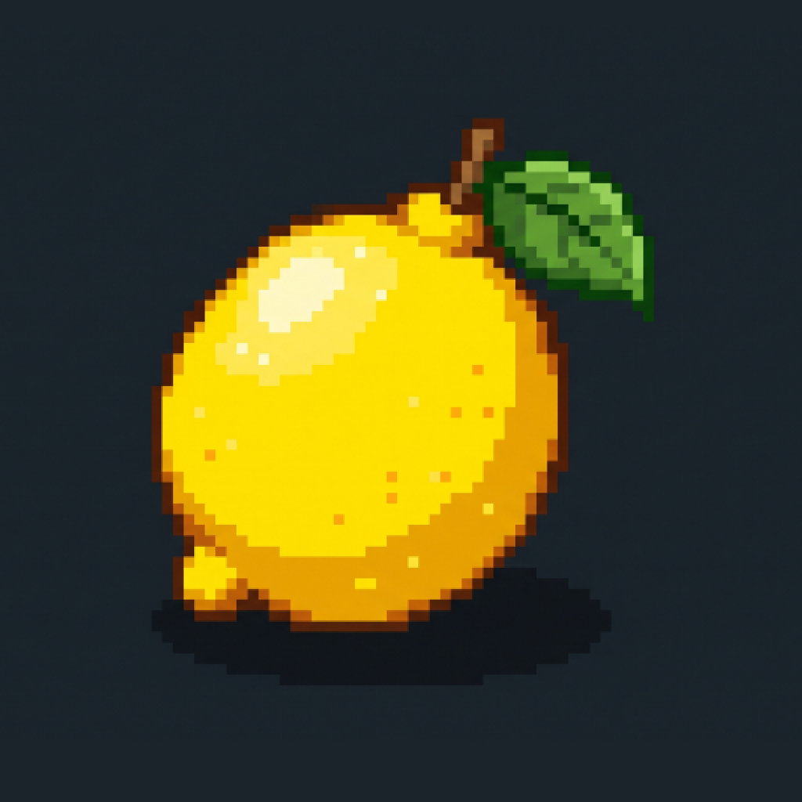

  

  <h1>👋 Hi, I'm Kasumi</h1>
  
  
<b>iOS Sideloading Enthusiast • Swift Developer • Reverse Engineering</b>

  

    
    
    
  

  

---

### 🌟 Featured Project: [LemonSign](https://github.com/Kasumi-dta/LemonSign)

> **LemonSign** is a fast, elegant, on-device iOS app signer and sideloading utility built with signature **Lemon Yellow** aesthetic.

- 🍋 **Lemon Yellow Branding**: Fully customized dark theme with pixel-art lemon identity.
- ⚡ **LemonTurbo Engine**: Multi-core parallel hashing and offline C++ `zsign` signing utilizing 100% of the device's CPU cores.
- 🔄 **In-App Auto-Updater**: Direct remote OTA update checking with 1-click update directly from GitHub Releases.
- 🛡️ **Real-Time Jailbreak Detection**: Live status indicator distinguishing stock iOS from rootless / rootful jailbreak environments.
- 📡 **Smart Localhost OTA Server**: One-click wireless installation with automatic server switching and SSL fallback.
- 💉 **Tweak & Dylib Injection**: Inject frameworks and dylibs directly into your favorite apps.

👉 **[Download Latest LemonSign Beta 3 (.IPA)](https://github.com/Kasumi-dta/LemonSign/releases/tag/beta3)** | 💬 **[Join Telegram Community](https://t.me/applep12vnn)**

---

### 🛠️ Tech Stack & Skills

| Domain | Technologies |
| :--- | :--- |
| **Languages** | `Swift` • `Objective-C` • `C / C++` • `Python` • `Shell / Bash` |
| **iOS Development** | `SwiftUI` • `UIKit` • `CoreData` • `Vapor Server` • `Mach-O / Dylib Injection` |
| **Security & Signing** | `zsign Core` • `Codesign / Entitlements` • `Jailbreak Detection` • `SSL / TLS` |
| **Tools & CI/CD** | `Xcode` • `Git / GitHub Actions` • `macOS Runner Automation` • `IPA Packaging` |

---

### 📊 GitHub Activity & Statistics

  
  

  

---

### 📬 Connect With Me

 

*Stay hungry, stay foolish — and keep it fresh like a lemon 🍋*

